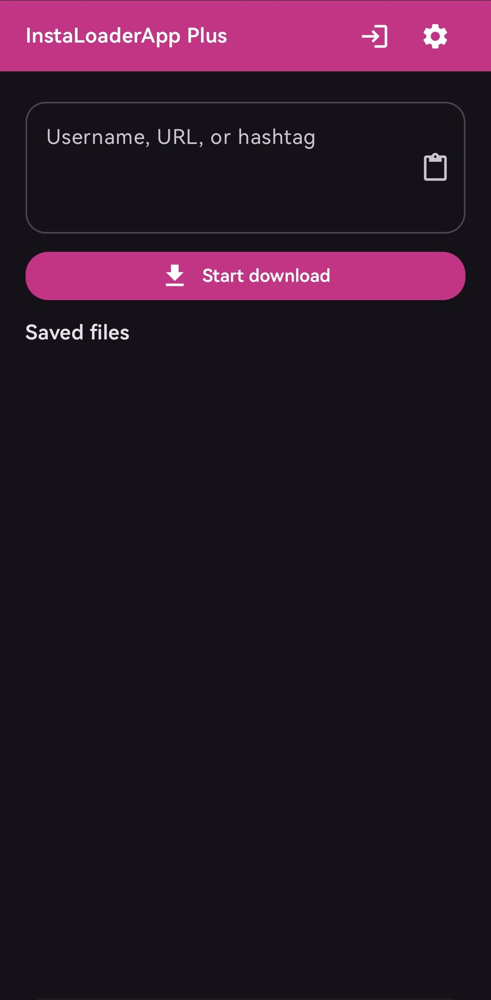

<div align="center">

# InstaLoaderApp Plus

### Bulk Instagram media downloader for Android.

Download profiles, posts, reels, and hashtags with [`instaloader`](https://github.com/instaloader/instaloader), with transfer progress, configurable download options, and optional Instagram login.

[](https://github.com/ospavel/InstaLoaderAppPlus/releases)
[](https://github.com/ospavel/InstaLoaderAppPlus)
[](https://github.com/ospavel/InstaLoaderAppPlus/releases)

</div>

## Overview

**InstaLoaderApp Plus** is a substantially reworked, actively maintained fork of [Azeem Idrisi's InstaLoaderApp](https://github.com/AzeemIdrisi/InstaLoaderApp). The Plus version keeps Instaloader 4.15.3 as its download engine and adds a redesigned interface, secure browser-based login, accurate transfer progress, and a built-in saved-file browser. It uses Jetpack Compose and Chaquopy, and runs downloads in a foreground service with notifications.

Files save under **`Downloads/InstaLoaderApp/`** by default. Change the destination in **Settings → Storage** and customize folder and file names with Instaloader patterns in **Settings → Paths**. The default filename pattern is **`{profile}_{filename}`**.

> [!TIP]
> Login is optional. It is needed only for private content and account features such as stories, highlights, and comments.

---

## Screenshot

<div align="center">



</div>

---

## Features

- Profiles, single post/reel URLs, and hashtags
- A compact home screen with a live transfer progress bar and download result
- A scrollable saved-file list with photo/video previews, newest files first, and tap-to-open in a compatible app
- Foreground downloads with progress notifications and cancellation
- Configurable media, metadata, filters, filename/folder patterns, and resume options
- Optional login through Instagram's own WebView, including its two-factor and security-check pages
- Public download folders, common storage presets, and a custom folder

---

## Installation

[Download the latest APK from GitHub Releases](https://github.com/ospavel/InstaLoaderAppPlus/releases/latest).

Install the APK. The current storage implementation asks for **All files access** (Android 11+) on the first download because it writes directly to public folders. This permission covers shared storage beyond the download folder; grant it only if you trust the app, and revoke it after use if you prefer. **Notifications** permission is requested on Android 13+.

---

## Usage

| Input           | Example                     | Default output folder                          |
| --------------- | --------------------------- | ---------------------------------------------- |
| Username        | `instagram`                 | `Downloads/InstaLoaderApp/<username>/`         |
| Post / reel URL | `https://instagram.com/p/…` | `Downloads/InstaLoaderApp/`                    |
| Hashtag         | `#travel`                   | `Downloads/InstaLoaderApp/hashtag_<tag>/`      |

1. Enter a username, URL, or hashtag → **Start download**.
2. For posts/reels, copy the link from Instagram and paste into the app.

By default, saved media filenames use **`{profile}_{filename}`**, combining the source account with Instaloader's original filename. Existing custom filename patterns are preserved when upgrading; an unset or blank pattern is migrated to the new default.

If a download fails, expand **Error details** in the progress card to see and copy the full exception. Review the details before sharing them, since request URLs may contain private information.

> [!WARNING]
> Large profiles can take a long time. Instagram may restrict accounts used for automated downloading — use a secondary account at your own risk if you log in.

---

## Instagram login and session safety

Open **Login** to sign in on Instagram's own page in an embedded WebView. Enter your password, two-factor code, and any requested security checks there. Credentials are not entered into native app fields or sent to a developer server. After sign-in, tap **Use this account**; the app reads the WebView session cookie and browser User-Agent, then asks Instaloader to verify the session with Instagram. An unverified session is rejected.

Only a confirmed session is saved. The normalized cookies and WebView's actual User-Agent are stored together in encrypted app preferences protected by Android Keystore. Session preferences and legacy session files are excluded from Android cloud backup and device transfer. Cookies act like account credentials: protect the phone and log out when you no longer need the session. Logging out removes the saved session, legacy session files, and WebView cookies. WebView cookies are also cleared after a successful session import.

The WebView cookie store is used while you sign in. Downloads use the captured WebView User-Agent for that session when the **User-Agent** setting is blank; a manually configured value takes precedence. The app keeps this browser identity consistent and does not rotate or invent a User-Agent. This does not prevent Instagram from challenging or restricting the account. Instagram may reject an embedded WebView or require an additional checkpoint; a session which Instaloader cannot verify will not be imported.

Older Instaloader session files are converted to encrypted cookie data locally when the app first restores that session. The old file is deleted only after encrypted storage succeeds.

---

## Build from source

### Docker (macOS)

Docker Desktop is required. The builder image contains JDK 17, Python 3.14, Android SDK Platform 35, and Android SDK Build-Tools 34.0.0. On Apple Silicon, Docker runs the Linux AMD64 builder through its built-in emulation. No Android SDK or JDK installation on macOS is required.

Build the signed release APK with the repository's Docker builder:

```sh
./build-release.sh
```

The first build downloads the builder image and Gradle dependencies. Later builds reuse the Docker image and the `instaloaderapp-gradle-cache` volume. The APK is written to `app/build/outputs/apk/release/app-release.apk`. A release build requires a local `keystore.properties` and signing key; both are excluded from Git. Back up both files, since the same key is needed to update an installed APK later.

For other Gradle tasks, call the Docker wrapper directly, for example:

```sh
sh docker/build-apk.sh testReleaseUnitTest assembleRelease
```

### Native macOS build

Install [Android Studio](https://developer.android.com/studio) and use its SDK Manager to install Android SDK Platform 35 and Android SDK Build-Tools 34.0.0. Install a [JDK 17 build for macOS ARM64](https://adoptium.net/temurin/releases/?version=17), then point `JAVA_HOME` at it. Chaquopy 17 also requires Python 3.14; the configured path in `app/build.gradle` is `/opt/homebrew/bin/python3`.

Set `sdk.dir` in `local.properties`, then run:

```sh
JAVA_HOME=/path/to/jdk-17 ./gradlew assembleRelease
```

---

## Disclaimer

Use responsibly. Download only content you may access. The developer is not responsible for misuse. During login, credentials are sent by the Instagram WebView to Instagram. The app does not send them to a developer server.

Licensed under [GPL-3.0](LICENSE).
